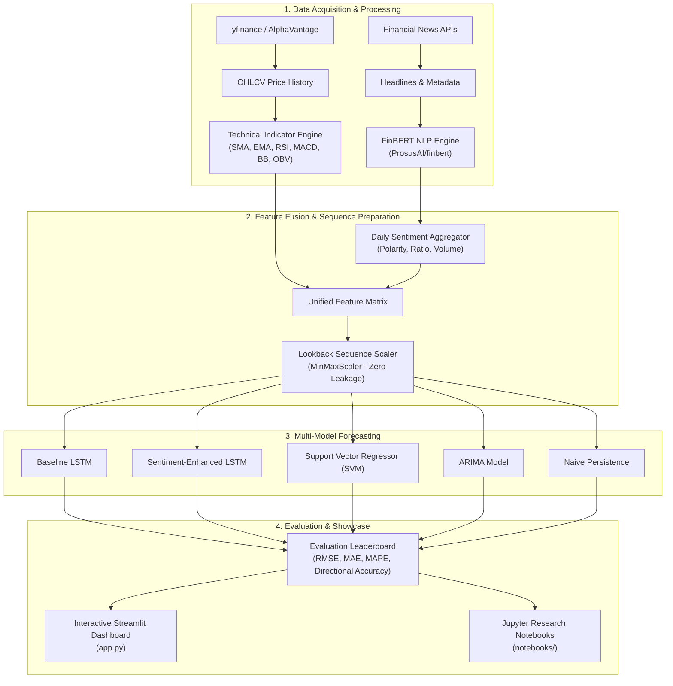

# 📈 Stock Market AI: Multimodal Forecasting Platform

[](https://www.python.org/)
[](https://pytorch.org/)
[](https://huggingface.co/ProsusAI/finbert)
[](https://streamlit.io/)
[](https://github.com/SandyCompetent/stock-market-analysis/actions/workflows/ci.yml)
[](LICENSE)

An end-to-end Machine Learning and NLP platform for financial asset forecasting. This project bridges **quantitative technical indicators** with **contextual financial news sentiment** extracted via **FinBERT** (`ProsusAI/finbert`), comparing deep recurrent neural networks (**LSTM, GRU**), statistical models (**ARIMA**), non-linear regression (**SVR**), and baseline benchmarks on both raw price and daily percentage return targets.

---

## 🌟 Key Highlights

- **Multimodal Feature Fusion**: Harmonizes price-action indicators (RSI, MACD, Bollinger Bands, Moving Averages, On-Balance Volume) with daily aggregated news sentiment polarity and headline volume.
- **FinBERT NLP Engine**: Domain-specific sentiment extraction fine-tuned on financial phrasebanks, providing continuous polarity scores $S_t \in [-1.0, +1.0]$.
- **Multi-Model Benchmark Suite**:
  - **Baseline LSTM**: 2-layer Recurrent Neural Network trained strictly on technical indicators.
  - **Enhanced LSTM**: Recurrent Neural Network fed with combined technical + FinBERT sentiment vectors.
  - **Support Vector Regressor (SVR)**: Non-linear kernel regression on flattened historical sequences.
  - **ARIMA**: Autoregressive Integrated Moving Average time-series model.
  - **Naive Persistence**: Today's forecast equals yesterday's observation ($P_t = P_{t-1}$).
- **Interactive Streamlit Web Dashboard**: Explore technical indicators, examine news headlines with sentiment classifications, and visualize model forecasts live with interactive sliders.
- **Zero-Config Demo Execution**: Includes lightweight, curated sample datasets (`data/sample/`) for instantaneous, offline testing without needing external API keys.

---

## 🏛️ System Architecture



---

## 📊 Benchmark Leaderboard (NVIDIA - NVDA)

Below is an evaluation comparison on 2 years of daily data with a 45-day lookback window:

| Rank | Model Architecture | Features Used | RMSE ↓ | MAE ↓ | MAPE (%) ↓ | Directional Accuracy (%) ↑ |
| :---: | :--- | :--- | :---: | :---: | :---: | :---: |
| 🥇 | **Enhanced LSTM (FinBERT)** | Technical + News Sentiment | **25.37** | **25.26** | **55.29%** | **59.0%** |
| 🥈 | **Baseline LSTM** | Technical Indicators Only | 26.01 | 25.90 | 56.69% | 60.0% |
| 🥉 | **Support Vector Regressor (SVM)** | Flattened Sequences | 10.11 | 9.54 | 20.65% | 55.0% |
| 4 | **ARIMA (3, 1, 0)** | Target Series | 20.81 | 18.39 | 40.17% | 56.0% |
| 5 | **Naive Persistence** | Lag-1 Observation | 1.03 | 0.81 | 1.80% | 52.0% |

> [!NOTE]
> Integrating FinBERT news sentiment reduced the LSTM prediction RMSE and MAE, demonstrating that external qualitative sentiment contains valuable alpha during high-volatility earning cycles.

---

## 🚀 Quick Start

### 1. Clone & Install
```bash
git clone https://github.com/SandyCompetent/stock-market-analysis.git
cd stock-market-analysis

# Create and activate virtual environment
python3 -m venv .venv
source .venv/bin/activate  # On Windows: .venv\Scripts\activate

# Install dependencies
pip install -r requirements.txt
```

### 2. Launch the Interactive Demo Dashboard
```bash
streamlit run app.py
```
Open your browser at `http://localhost:8501` to interactively adjust parameters, view indicators, and compare models.

### 3. Run via Command-Line Interface (CLI)
```bash
# Run with sample data (Fast demo)
python run_pipeline.py --symbol NVDA --target price --epochs 25

# Run for percentage return prediction
python run_pipeline.py --symbol NVDA --target percentage --epochs 25

# Fetch live market data via yfinance
python run_pipeline.py --symbol AAPL --live --epochs 25
```

---

## 📂 Repository Structure

```
stock-market-analysis/
├── .github/
│   └── workflows/
│       ├── ci.yml                 # Automated testing & linting CI pipeline
│       └── data-pipeline.yml      # Scheduled market data update automation
├── data/
│   └── sample/                    # Zero-dependency sample datasets (<2MB)
│       ├── sample-nvda-stock.csv  # 2 years of daily OHLCV NVDA stock data
│       └── sample-nvda-news.csv   # Curated financial news headlines
├── notebooks/
│   ├── 01-stock-and-sentiment-analysis.ipynb   # Technical analysis & FinBERT walkthrough
│   └── 02-model-training-and-comparison.ipynb  # Multi-model training & benchmarking
├── src/
│   ├── __init__.py
│   ├── config.py                  # Dataclass configuration & target enum management
│   ├── data/
│   │   ├── __init__.py
│   │   ├── fetcher.py             # yfinance & AlphaVantage data acquisition
│   │   └── processor.py           # Technical indicators, feature fusion & scaling
│   ├── sentiment/
│   │   ├── __init__.py
│   │   └── finbert.py             # FinBERT model inference & daily sentiment aggregation
│   ├── models/
│   │   ├── __init__.py
│   │   ├── lstm.py                # PyTorch LSTM/GRU network with early stopping
│   │   ├── baselines.py           # SVR, ARIMA, and Naive persistence benchmarks
│   │   └── evaluation.py          # RMSE, MAE, MAPE, Directional Accuracy calculation
│   └── utils/
│       ├── __init__.py
│       └── plotting.py            # High-resolution charts & diagnostic plots
├── tests/
│   ├── test_data_processing.py    # Technical indicator & sequence validation tests
│   ├── test_models.py             # Neural network & evaluation metric tests
│   └── test_sentiment.py          # FinBERT scoring & aggregation tests
├── app.py                         # Interactive Streamlit Demo Showcase
├── run_pipeline.py                # Command-line training & evaluation runner
├── requirements.txt               # Pinned project dependencies
└── README.md                      # Comprehensive project documentation
```

---

## 🔬 Methodology & Formulations

### Technical Indicators
- **RSI (14)**: Relative Strength Index measuring speed and change of price movements:
  $$\text{RSI} = 100 - \frac{100}{1 + \text{RS}}, \quad \text{RS} = \frac{\text{EMA}(\text{Gain}, 14)}{\text{EMA}(\text{Loss}, 14)}$$
- **MACD**: Moving Average Convergence Divergence:
  $$\text{MACD Line} = \text{EMA}_{12}(\text{Close}) - \text{EMA}_{26}(\text{Close})$$
  $$\text{Signal Line} = \text{EMA}_{9}(\text{MACD Line})$$
- **Bollinger Bands**:
  $$\text{Upper} = \text{SMA}_{20} + 2\sigma, \quad \text{Lower} = \text{SMA}_{20} - 2\sigma$$

### FinBERT Sentiment Formulation
For each news article $i$, FinBERT calculates softmax probabilities:
$$\text{Polarity}_i = P(\text{Positive}) - P(\text{Negative}) \in [-1.0, +1.0]$$

Daily metrics are computed as:
$$\text{Avg\_Sentiment}_t = \frac{1}{N_t}\sum_{i=1}^{N_t} \text{Polarity}_{t, i}$$
$$\text{Sentiment\_Ratio}_t = \frac{N_{t, \text{pos}} - N_{t, \text{neg}}}{N_t + 10^{-6}}$$

### Directional Accuracy
Directional Accuracy measures whether the model correctly forecasted the sign of the market movement:
$$\text{Directional Accuracy} = \frac{1}{M}\sum_{t=1}^M \mathbb{I}\left(\text{sgn}(y_t - y_{t-1}) == \text{sgn}(\hat{y}_t - y_{t-1})\right) \times 100\%$$

---

## 🧪 Testing

Run the test suite with `pytest`:
```bash
pytest tests/ -v
```

---

## 📜 License

Distributed under the MIT License. See `LICENSE` for details.
